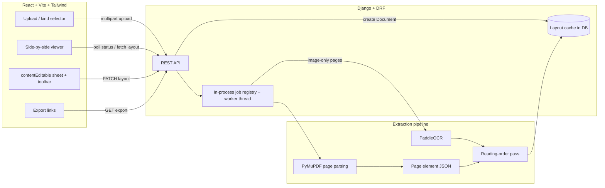

# High-Level Design — Layout-Preserving OCR Editor

## 1. Problem statement and scope

Text extraction alone is not the goal. The goal is to turn a scanned or digital
document into a **structured, editable representation that still looks like the
source page**, and to let a person compare, correct and export it.

In scope:

- PDF and image upload (multi-page PDFs included).
- Text extraction from digital PDFs (native text layer) and scanned pages (OCR).
- Bounding boxes, font styling, images and vector fills retained per page.
- Side-by-side original / editable reconstruction in the browser.
- Inline correction of text and basic styling.
- Export to PDF, DOCX, HTML, TXT and layout JSON.

Out of scope for this version: handwriting recognition, full semantic region
classification (heading, caption, list, table as typed objects), and
authentication/multi-user accounts.

## 2. Architecture



## 3. Components

| Layer | Component | Responsibility |
|---|---|---|
| Frontend | `UploadDoc.jsx` | Drag/drop upload, file-type and size guard, document kind. |
| Frontend | `DocumentViewer.jsx` | Original page rendering, editable reconstruction, styling toolbar, save and export. |
| Frontend | `services/api.js` | Single API client; configurable origin via `VITE_API_BASE_URL`. |
| Backend | `documents.views` | Upload/list/delete, layout fetch/save, status polling, export. |
| Backend | `documents.pymupdf_extractor` | Page parsing, image/vector extraction, PDF/HTML reconstruction. |
| Backend | `documents.paddleocr_engine` | Thread-safe PaddleOCR wrapper, box → element conversion with confidence. |
| Backend | `documents.serializers` | Metadata, upload validation, page count. |
| Storage | SQLite + media directory | Document rows, cached layout JSON, uploaded files. |

## 4. Upload-to-editor data flow

1. Client posts `multipart/form-data` to `POST /api/documents/` with `file` and
   `document_kind` (`normal` | `scanned`).
2. Serializer rejects unsupported extensions, empty files and files above
   `DJANGO_UPLOAD_MAX_FILE_SIZE` (20 MB default).
3. The file is stored under `MEDIA_ROOT/documents/`, a `Documents` row is
   created with `status=pending`.
4. A background thread starts extraction and flips status to `processing`.
5. The client navigates to `/document/<id>` and polls
   `GET /api/documents/<id>/status/` while showing progress.
6. `GET /api/documents/<id>/layout/` returns the cached layout when present,
   otherwise `202` with the current job state.
7. Edits are persisted with `PATCH /api/documents/<id>/layout/` (whole layout
   object) and exports read the same cached JSON.

## 5. Processing pipeline

`extract_document_layout(file_path, use_ocr, on_progress)`:

1. **Image input** — treated as a single scanned page; OCR runs directly.
2. **PDF input** — each page is parsed with `page.get_text("dict")`:
   - text blocks → one element per text line, with bbox, font family, size,
     colour, bold/italic flags;
   - image blocks → data-URI elements, flagged `isBackground` when the image
     covers ≥85% of the page (scanned page);
   - vector drawings → `fill` elements for table cell backgrounds/borders.
3. **OCR fallback** — if a page has fewer than `MIN_NATIVE_TEXT_CHARS` native
   characters (or `use_ocr` is set and the page is empty), the page is rendered
   at `OCR_DPI` and passed to PaddleOCR. OCR elements replace the background
   scan and carry a `confidence` score.
4. **Reading order** — `_apply_reading_order` looks for a vertical gutter with
   no text coverage; if a clear two-column split exists (≥3 lines per column),
   text elements are re-sorted column-major. Otherwise source order is kept.
5. The page object is stored with `layout_version` so stale caches are rebuilt.

## 6. Page representation

Page geometry uses PDF points (72 dpi); all rendering is proportional, so the
same JSON works at any zoom.

```json
{
  "pages": [
    {
      "page_number": 1,
      "width": 595.2,
      "height": 841.92,
      "elements": [
        {
          "id": "page-1-el-0",
          "type": "text-line",
          "text": "Introduction",
          "bbox": { "x": 72.0, "y": 96.4, "width": 180.2, "height": 14.0 },
          "style": {
            "fontFamily": "Times New Roman, Times, serif",
            "fontSize": 14.0,
            "color": "#000000",
            "bold": true,
            "italic": false
          }
        },
        {
          "id": "page-1-img-1",
          "type": "image",
          "src": "data:image/png;base64,...",
          "bbox": { "x": 72.0, "y": 200.0, "width": 300.0, "height": 180.0 },
          "isBackground": false
        },
        {
          "id": "page-1-ocr-0",
          "type": "text-line",
          "text": "Scanned paragraph",
          "confidence": 0.87,
          "source": "paddleocr",
          "bbox": { "x": 72.0, "y": 400.0, "width": 400.0, "height": 12.0 },
          "style": { "fontSize": 12.0 }
        }
      ]
    }
  ],
  "ocr_engine": "paddleocr",
  "layout_version": 3
}
```

Element types: `text-line`, `image`, `fill`. `fill` elements reproduce table
backgrounds and dividers; they are rendered below text and are not editable.

## 7. Editor representation

- The reconstructed page is a fixed-aspect sheet; every element is absolutely
  positioned with percentages derived from `bbox / page_size`.
- Text lines are `contentEditable` divs; `onBlur` writes the new text back into
  layout state. The toolbar mutates `fontSize`, `bold`, `italic`, alignment and
  colour for the selected element (alignment is applied at export time).
- OCR lines with `confidence < 0.8` get a dotted underline and a tooltip so the
  reviewer knows what to check.
- Saving serialises the full layout and `PATCH`es it; exports are generated
  server-side from the same object.

## 8. API

| Method | Path | Purpose |
|---|---|---|
| `GET` | `/api/documents/` | List documents (newest first). |
| `POST` | `/api/documents/` | Upload (`file`, `document_kind`). |
| `GET` | `/api/documents/<id>/` | Document metadata + extracted text. |
| `DELETE` | `/api/documents/<id>/` | Delete document and file. |
| `GET` | `/api/documents/<id>/status/` | `{status, page, total, error, has_layout}`. |
| `GET` | `/api/documents/<id>/layout/` | Cached layout; `202` + job state while processing. |
| `PATCH` | `/api/documents/<id>/layout/` | Persist edited layout. |
| `GET` | `/api/documents/<id>/pages/<n>/` | Rendered page image (PNG/JPEG). |
| `GET` | `/api/documents/<id>/export/?export_format=` | `pdf`, `docx`, `html`, `txt`, `json`. |

Error behaviour: `400` for validation and unsupported export formats, `404` for
missing documents/pages, `202` while extraction is in flight.

## 9. Storage

- `Documents`: file, original name, type, size, kind, status, timestamps.
- `ExtractedText`: one-to-one with `Documents`; flattened `text` plus
  `layout_data` JSON.
- Files live under `MEDIA_ROOT/documents/`; SQLite is the default database.
- Layout caching avoids re-running OCR on every open; `layout_version`
  invalidates older caches.

## 10. Large and multi-page documents

- Extraction runs outside the request cycle, so a 10-page scan does not hit the
  proxy timeout.
- Only one job per document may run; progress is reported page-by-page.
- If the dev server restarts mid-job, the status endpoint restarts extraction
  when no layout exists.
- Layout JSON is stored whole; a production version should split per page.

## 11. Error handling and retry

- Validation errors return structured DRF messages and are shown in the UI.
- OCR failures are caught per page and fall back to native text; the document
  is marked `failed` only if the whole job raises.
- `GET /layout/` supports `?refresh=true` to force re-extraction.
- The viewer exposes a "Retry extraction" action on failure.

## 12. Security

- Uploads are validated server-side (extension allowlist, non-empty, size cap).
- Secrets are environment-only (`DJANGO_SECRET_KEY` is mandatory, `.env` is
  gitignored, `.env.example` documents the variables).
- `DEBUG` defaults to `False`; production adds HSTS, secure cookies and SSL
  redirect.
- CORS is an explicit allowlist by default (`CORS_ALLOW_ALL_ORIGINS` opt-in).
- Media is served by Django only when `DEBUG` or `DJANGO_SERVE_MEDIA` is set;
  production should use object storage/CDN instead.

## 13. Deployment

- The API runs under gunicorn with whitenoise for static files; the frontend is
  a static Vite build served by any static host.
- `deploy/hf-space/` holds the Dockerfile and Space card used by
  `scripts/deploy_hf_space.py`; gunicorn runs a **single worker** because job
  state is kept in process memory.
- Required variables: `DJANGO_SECRET_KEY`, `DJANGO_ALLOWED_HOSTS`,
  `CORS_ALLOWED_ORIGINS`, and on the frontend `VITE_API_BASE_URL`.
- The PaddleOCR stack needs roughly 2 GB of RAM; free tiers with 512 MB will
  fail on scanned documents.
- Demo hosts use an ephemeral filesystem: uploaded files and SQLite do not
  survive a redeploy. A persistent disk or Postgres + object storage is the
  production answer.

## 14. Technology choices and alternatives

| Choice | Why | Alternatives considered |
|---|---|---|
| React + Vite | Fast dev loop, simple SPA, no SSR requirement. | Next.js (more setup than needed). |
| Django + DRF | Strong file/serializer tooling, admin, clear API layer. | FastAPI (lighter but more manual). |
| PyMuPDF | Exact text, font and vector geometry from PDFs; renders pages for OCR. | pdfplumber, pdfminer (weaker geometry/vector data). |
| PaddleOCR | Strong printed-text accuracy, open source, CPU mobile models, word boxes. | Tesseract (weaker on complex layouts), EasyOCR (slower, larger). |
| Absolute-positioned `contentEditable` | Directly mirrors bbox model; no rich-text schema mismatch. | ProseMirror/TipTap (better editing semantics, harder layout fidelity). |
| SQLite + local media | Zero-config prototype storage. | PostgreSQL + S3 (production). |

## 15. Known limitations

- OCR is line-based; paragraphs are not merged, and semantic roles are not
  classified.
- Table structure is approximated from vector fills/dividers, not reconstructed
  as a table model.
- The reading-order heuristic only handles a single clear gutter; three-column
  and nested layouts are not solved.
- Multi-page exports rebuild each page independently; page breaks are inserted
  in DOCX, but cross-page flows are not reflowed.
- Handwriting and low-resolution photos degrade OCR quality.
- No authentication: the demo is single-tenant and public.
